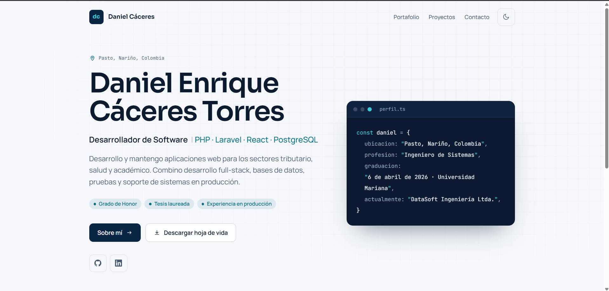

# Portafolio profesional — Daniel Enrique Cáceres Torres

Portafolio personal de **Ingeniero de Sistemas y desarrollador de software**. El frontend está hecho en **Vue.js** y el backend propio en **Django**: el contenido se administra desde un panel sin modificar código, los visitantes pueden escribirme desde un formulario protegido y el sitio registra estadísticas anónimas.



## Tecnologías

| Capa | Tecnologías |
| --- | --- |
| Frontend | Vue.js 3 · Vite · Tailwind CSS · Vue Router |
| Backend | Python · Django · Django REST Framework · PostgreSQL |
| Seguridad | Cloudflare Turnstile · django-axes · django-cors-headers |

## Qué incluye

**Secciones del sitio**

- **Portada:** presentación, stack principal, distinciones, descarga de la hoja de vida y enlaces a GitHub y LinkedIn.
- **Sobre mí:** biografía, enfoque de trabajo y stack tecnológico agrupado por uso.
- **Experiencia:** trayectoria laboral con funciones y tecnologías de cada cargo.
- **Proyectos:** estado, rol, tecnologías, detalle y enlace al repositorio de cada proyecto.
- **Formación:** título universitario, investigación y certificados con visor de PDF.
- **Hoja de vida:** vista previa y descarga en PDF.
- **Contacto:** formulario para enviar mensajes.

**Funcionalidades**

- **Contenido administrable:** perfil, experiencia, proyectos, certificados y stack se editan desde el panel de Django y se muestran en el sitio con el mismo diseño.
- **API REST:** el frontend obtiene el contenido de la API y usa una copia local como respaldo si el backend no responde.
- **Formulario de contacto:** los mensajes se guardan en la base de datos y llegan por correo.
- **Estadísticas anónimas:** visitas, secciones vistas, descargas de la hoja de vida, certificados abiertos y clics en repositorios, sin guardar IP ni datos personales.
- **Documentos protegidos:** la hoja de vida y los certificados se entregan a través de la API; los que contienen datos personales nunca se publican.
- **Interfaz:** diseño responsive, modo claro y oscuro, y accesibilidad (navegación por teclado y lectores de pantalla).

## Seguridad

- Formulario protegido con **Cloudflare Turnstile** (verificado en el servidor), un campo trampa para bots y un **límite de 5 mensajes por hora** por IP.
- Panel de administración en una **ruta privada** y **bloqueo tras 5 intentos fallidos** de inicio de sesión.
- **CORS restringido:** solo el frontend autorizado puede consumir la API.
- Correos de notificación en **texto plano**, para evitar inyección de HTML.
- En producción: HTTPS obligatorio, HSTS, cookies seguras y protección contra clickjacking.

### Variables de entorno

Las contraseñas y llaves **no están en este repositorio**. Viven en archivos `.env` que Git ignora. Para ejecutar el proyecto se incluyen plantillas sin datos privados:

- `backend/.env.example`: llave de Django, base de datos, correo, Turnstile y ruta del panel.
- `frontend/.env.example`: dirección de la API y llave pública de Turnstile.

Copia cada plantilla como `.env` y completa tus propios valores.

## Estructura

```
portafolio/
├── backend/              API y panel de administración (Django)
│   ├── apps/core/        Contenido del portafolio
│   ├── apps/contact/     Formulario de contacto
│   ├── apps/analytics/   Estadísticas
│   └── config/           Configuración
├── frontend/             Sitio web (Vue + Vite)
└── requirements.txt      Dependencias de Python
```

## Cómo ejecutarlo en tu computador

**Requisitos:** Python 3.12 o superior, Node.js 20 o superior y PostgreSQL.

### 1. Clonar el repositorio

```bash
git clone https://github.com/Daniel99c/Portafolio.git
cd Portafolio
```

### 2. Crear la base de datos

En PostgreSQL, crea una base de datos y un usuario para el proyecto (por ejemplo, `portafolio_db`).

### 3. Backend

```bash
python -m venv venv
venv\Scripts\activate          # Linux/Mac: source venv/bin/activate
pip install -r requirements.txt

cd backend
copy .env.example .env         # Linux/Mac: cp .env.example .env
```

Abre `backend/.env` y completa los datos de tu base de datos, una `SECRET_KEY` y `DEBUG=True`. Para trabajar en local agrega `ALLOWED_HOSTS=localhost,127.0.0.1` y `CORS_ALLOWED_ORIGINS=http://localhost:5173`. Si dejas `TURNSTILE_SECRET_KEY` vacío, se usa la llave de prueba de Cloudflare.

```bash
python manage.py migrate
python manage.py createsuperuser
python manage.py cargar_contenido
python manage.py runserver
```

- La API queda en `http://localhost:8000/api/portfolio/`.
- El panel de administración queda en `http://localhost:8000/` seguido de la ruta que pongas en `ADMIN_URL`.

### 4. Frontend

En otra terminal:

```bash
cd frontend
npm install
npm run dev
```

Abre `http://localhost:5173` en el navegador.

> El frontend también funciona sin el backend: muestra el contenido de respaldo, pero sin formulario de contacto ni estadísticas.

## Autor

**Daniel Enrique Cáceres Torres** — Ingeniero de Sistemas, Universidad Mariana

[LinkedIn](https://www.linkedin.com/in/daniel-enrique-caceres-torres-b70ab432b) · [GitHub](https://github.com/Daniel99c)
